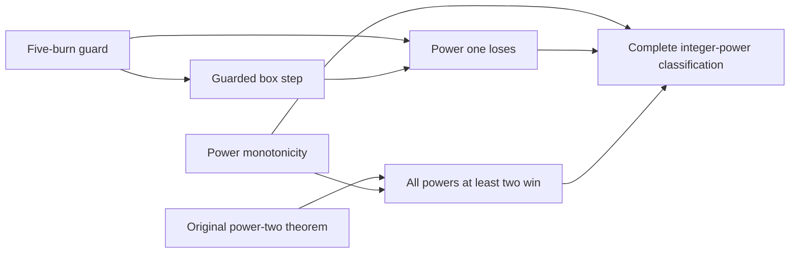

# Integer-power classification — 2026-10-19

The standard infinite-board game is now classified for every natural-number
Angel power. All six extension submissions were **ACCEPTED** by Prove2Me.

- `power_one_devil_wins`: one Devil strategy defeats **every** power-one Angel strategy.
- `power_ge_two_wins`: every integer power at least two has a winning Angel strategy.
- `angelWins_iff_two_le`: `AngelWins p ↔ 2 ≤ p`, including the degenerate power zero.
- Locally, `devilWins_iff_le_one` also proves the complementary Devil classification.

This formalizes known mathematics, not a new solution to the Angel problem.
The one-power argument follows Berlekamp's king-capture method as explained by
Martin Kutz, PhD thesis (2004), Chapter 1, Section 1.1, pp. 2–3, Figures 1–3.
The higher-power direction reuses the completed Máthé 2007 formalization.
See [source metadata](../papers/king-source.json).

## Closed local verification

`python scripts/verify.py` builds `Solutions.PowerClassification`, checks the
exact types of the original three targets and the new classification targets,
and audits **228 theorems**. Every dependency is in the allowlist `propext`,
`Classical.choice`, `Quot.sound`; there is no `sorryAx` or additional axiom.
The reference statements in `Theorems/` deliberately remain placeholders and
are not imported by the closed library. Platform packages import these mirrors
to represent server dependencies; their local elaboration alone is not a
closed proof. See `local-checks.json`, `build.log`, and `axioms.log`.

The finite line-guard search only generates a proof tree. Lean checks every
chosen burn and every branch using ordinary kernel-checked `decide`, not
`native_decide`. Regenerate it with `python scripts/generate_king_guard.py`.

## Source-to-model comparison

The original `Def_AngelDevil_Game` is unchanged. Rounds remain Devil-first;
the Devil burns at most one square, may pass or repeat a selection, and may
burn the currently occupied square. A later landing on a burned square loses.
The Angel may stay still. The proof covers these conventions, including
stalling, rather than assuming that the king moves north or never revisits.

The implementation uses a radius-100 square and a list of 56 corner selections,
with duplicates allowed. After preparation the king is within radius 56.
Each nearby boundary is defended by a five-burn guard; when two boundaries
are nearby their preblocked corner arms already supply the necessary triples.
A tactical selection that is already burned can be replaced by any fresh
square inside the box. The number of remaining squares then strictly decreases.

The formal finite obstruction is at horizon `56 + (kingBoard.card + 1)`.
This deliberately loose implementation bound is not advertised as an optimal
capture time, nor as the 33-by-33 result mentioned in the literature. The
history-only winning Devil is obtained through the existing finite-viability
construction; an efficient playable strategy implementation is not claimed.

## Platform proofs and actual dependency graph

| Result | Theorem ID | Submission ID |
|---|---|---|
| Five-burn guard | `8799e326-d7d8-4969-9a45-0d8ed06b4322` | `b58425d6-1269-41e7-8006-d17a4ec64324` |
| Guarded box step | `933979c6-a215-44e2-b9ef-686e0ccba8dc` | `3737259d-c150-4d52-9591-1aa190addda5` |
| Winning monotonicity | `2c3d6ee4-b479-4ba2-87ca-270e8e9c8027` | `1ab1767e-a9a6-4fdb-961a-4b54c7e3a09d` |
| All powers at least two | `fd3adddf-c5e8-45db-a5ca-d80d9907541d` | `ce542f0a-304a-4da3-9123-50224a3fb2c0` |
| One Devil defeats all power-one Angels | `26888492-cdea-4b37-b3a2-327d25204e18` | `7cc072a7-5bf9-4c69-8a97-d69d1af8b32f` |
| Complete Angel classification | `78319c36-be90-44b7-ae39-6f212616b326` | `4a294f28-9ba8-4c8a-99ca-e34ba71f08b3` |

All six theorem states are **Proved**. The classification graph at returned depth 10
contains **37 nodes, 66 edges, zero open leaves**, and no unexpanded adjacency
flags. Its proof edges include the following actual dependencies:

These arrows are verified child → submission-node → parent paths, not inferred
from documentation. Full state, decomposition, graph, open-leaf, and submission
responses are in `classification-platform/`; the checked summary is
`classification-checks.json`. The original Máthé proof remains an unchanged
upstream result. Auxiliary definition imports are recorded separately from
the mathematical theorem edges above.

At the final live check the original proposal was **Reviewed**, and public
mission `6ca204ff-f20b-44be-9d36-410667a76662` was listed with its original main theorem
**Proved**. See `classification-platform/proposal-current-state.json` and
`mission-current-state.json`. This extension did not change the original mission
target. No journal publication or independent peer review is claimed.
